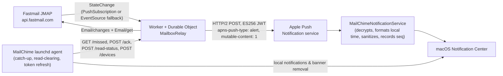
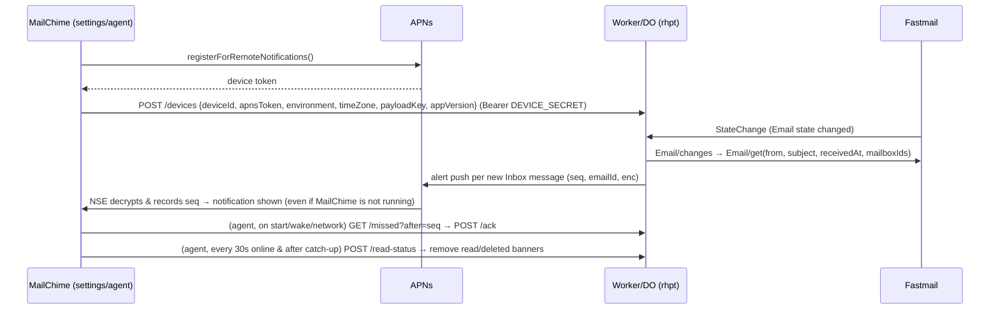

# MailChime → JMAP + Cloudflare Workers + APNs — Implementation Plan (v2)

## Goal

**Fastmail (JMAP push) → Cloudflare Worker + Durable Object → APNs → macOS notification**, for every new INBOX message.

Core behavior: title `"Here's The Mail!"`, body with `From:` / `Subject:` / `Received:` (shown in the Mac's local time zone), the `Notification_A.aiff` sound, clicking opens the default mail app without opening the Settings window, mail is never marked read, and notifications are automatically removed when read or deleted elsewhere.

## Architecture

### Key design decisions

1. **The system displays alert pushes.** Each message is sent as an `alert` push (priority 10), so macOS shows it **even when MailChime is not running**. The launchd agent (`com.rhpt.mailchime.agent`) handles catch-up, read-clearing, and token refresh rather than polling for new mail.
2. **A Notification Service Extension handles every push.** The payload sets `mutable-content: 1`, so `MailChimeNotificationService.appex` runs for each push. It decrypts `enc` with the shared-Keychain payload key, reformats `Received` from the ISO `receivedAt` into the Mac's current locale and time zone, applies header sanitization, sets `Notification_A.aiff`, tags `userInfo["mailchimeMail"]`, and records the push's `seq` in `delivered.json` in the shared App Group container. If the extension fails or times out (~30 s), macOS shows the generic alert (`"Here's The Mail!"` / `"New message"`) as is, because sender and subject exist only inside the encrypted payload (decision 2).
3. **Catch-up covers APNs offline coalescing.** While a Mac is asleep or offline, APNs stores **only the most recent notification** per app, so a burst of mail arriving during sleep would otherwise produce a single notification. To fill the gap, the launchd agent runs at start/login, on wake (`didWakeNotification`), and when the network becomes satisfied (`NWPathMonitor`), after a 5 s settle delay. It calls `GET /missed?deviceId=...&after=<lastAckedSeq>`, posts local notifications only for `seq`s the extension did not record, and then sends `POST /ack`. The Durable Object (DO) keeps a bounded queue of email IDs (1,000 entries or 7 days) until they are acknowledged.
4. **Read and deleted mail auto-clearing.** While online and enabled, the agent runs `ReadNotificationReconciler` every 30 s (and after catch-up / manual checks). It snapshots delivered notifications in Notification Center, queries `POST /read-status` (batched up to 50 email IDs, up to 200 per pass, rate-limited to 8 requests/min, executing outside the DO's serial delivery queue), verifies snapshot identity/date before removal, and removes any notifications whose emails are `$seen` (`read`) or `notFound` at Fastmail.
5. **Header text is never stored at rest by MailChime or the Worker, and Apple never sees it.** The DO stores only the JMAP state, the Inbox ID, email IDs with `seq`, and the single device registration (APNs token and that device's payload key). `From` and `Subject` are fetched just in time and **encrypted end to end** (Phase 4) before each push, and again for `/missed`. The visible APNs alert carries only the generic text `"New message"`, and `MailChimeNotificationService` decrypts and rewrites it on the Mac.
6. **Fastmail ingestion and subscription maintenance.** The primary path is JMAP `PushSubscription` to `https://rhpt.mym5n442j7.workers.dev/jmap/push/<PUSH_PATH_SECRET>` with `deviceClientId` configured via `JMAP_DEVICE_CLIENT_ID` (`mailbox-relay`), verification-code handshake, automatic replacement if `deviceClientId` or `callbackURL` changes, and renewal by alarm. The fallback is an EventSource held by the DO and reconnected about every 10 minutes. As a safety net, a reconcile `Email/changes` runs every 5 minutes (also backed by a `*/5 * * * *` cron trigger). Baseline semantics are kept: existing mail never triggers notifications.
7. **Every new INBOX message is notified (decision 1: Inbox only).** "New" means `created` in `Email/changes` and `mailboxIds` contains the Inbox (`Mailbox/query role:inbox`). Mail filed into other folders, including by Fastmail rules, does not notify. There is no keyword or sender filtering.
8. **Single device (decision 3).** `POST /devices` replaces any previous registration, so there is one APNs token, one payload key, and one `lastAckedSeq` cursor. The storage schema keys these by `deviceId` so adding Macs later only requires fan-out and per-device cursors, not a migration.

## Apple Developer setup (what APNs entails)

| # | Item | Details |
|---|---|---|
| 1 | Paid Apple Developer Program membership | Team `F8AV3SGQFB` (`Developer ID Application: Randy Tjahjono (F8AV3SGQFB)`) |
| 2 | App ID `com.rhpt.mailchime` | **Push Notifications** and **App Groups** capabilities |
| 3 | App ID `com.rhpt.mailchime.NotificationService` | **App Groups** capability |
| 4 | App Group `$(TeamIdentifierPrefix)com.rhpt.mailchime` | Shared container (`F8AV3SGQFB.com.rhpt.mailchime`) for `delivered.json`, `cursor.json`, `registration.json`, `read-status.json`, `read-provenance.json`, and lock files |
| 5 | Keychain access group `$(AppIdentifierPrefix)com.rhpt.mailchime.shared` | **Required** (decision 2). Lets the app, agent, and extension share `relay-credentials` and `payload-key-<identity>` in the Data Protection Keychain (`service: com.rhpt.mailchime.relay`) |
| 6 | APNs Auth Key (`.p8`) | One key (`APNS_KEY_ID` / `APNS_KEY_P8`) covers both sandbox and production |
| 7 | Register this Mac's Provisioning UDID | Needed for development provisioning profiles |
| 8 | Provisioning profiles | **Development** profiles (`development`) and **Developer ID** direct-distribution profiles (`production`) for both targets |
| 9 | Notarization | **Required**. Developer ID builds are notarized (`xcrun notarytool`) and stapled (`xcrun stapler`) for Gatekeeper |

**APNs environment:** Debug builds signed with a development profile get `aps-environment = development` and use `api.sandbox.push.apple.com`. Developer ID or Release builds get `production` and use `api.push.apple.com`. `PushEnvironment.current()` reads the signed `com.apple.developer.aps-environment` entitlement directly (falling back to `MailChimeAPNsEnvironment` in `Info.plist`, set from `MailChime_APS_ENVIRONMENT[config=Debug|Release]`).

## Implemented Architecture & Components

### Phase 0 — Capability spike

- [probe.ts](file:///Users/rhpt/Documents/Projects/MailChime/relay/scripts/probe.ts) (`POST /probe`) checks:
  - Fastmail: `/jmap/session` capabilities, `Email/set` no-op probe (`readOnly: 'confirmed' | 'unverified'`), and `PushSubscription/set` acceptance/verification.
  - APNs: JWT-signed test push from the **deployed** Worker when `APNS_TEST_TOKEN` and `APNS_ENVIRONMENT` are supplied.
- APNs requires HTTP/2. Deployed Workers negotiate HTTP/2 for outbound `fetch`, while local `vitest` tests use mocks.

### Phase 1 — Cloudflare Worker (`relay/`)

| File | Purpose |
|---|---|
| [wrangler.jsonc](file:///Users/rhpt/Documents/Projects/MailChime/relay/wrangler.jsonc) | Worker `rhpt` on `workers.dev`, DO binding `MAILBOX_RELAY` (`new_sqlite_classes: ["MailboxRelay"]`), `*/5 * * * *` cron, vars `APNS_TEAM_ID=F8AV3SGQFB`, `APNS_TOPIC=com.rhpt.mailchime`, `JMAP_DEVICE_CLIENT_ID=mailbox-relay`, `RELAY_URL=https://rhpt.mym5n442j7.workers.dev` |
| [index.ts](file:///Users/rhpt/Documents/Projects/MailChime/relay/src/index.ts) | Routes: `GET /health` (`{ ok: true, service: 'mailchime-relay', version: 1, deployment }`), `POST /jmap/push/:secret`. Device-authenticated (Bearer `DEVICE_SECRET`, constant-time compare): `POST /devices`, `DELETE /devices/:id`, `GET /missed?after=`, `POST /ack`, `POST /read-status`, `POST /test`, `GET /status`, `POST /probe` |
| [relay.ts](file:///Users/rhpt/Documents/Projects/MailChime/relay/src/relay.ts) | `MailboxRelay` DO (SQLite `relay_state` table): baseline, `StateChange` → new Inbox emails → `seq` → encrypted APNs push to the single registered device; `/missed` & `/ack` queue pruning (1,000 entries / 7 days); `/read-status` (max 50 IDs, 8 req/min, non-serial path); alarms (PushSubscription renewal/replacement, 5-min reconcile, EventSource reconnect, APNs retry backoff) |
| [apns.ts](file:///Users/rhpt/Documents/Projects/MailChime/relay/src/apns.ts) | ES256 JWT via `crypto.subtle` (PKCS#8 `.p8`), cached 40 min. Headers: `apns-topic`, `apns-push-type: alert`, `apns-priority: 10`, `apns-expiration` (+24 h), `apns-collapse-id` (SHA-256 of email ID). Error handling: `410 Unregistered` / `400 BadDeviceToken` → remove device; `403 ExpiredProviderToken` → refresh JWT and retry; `429`/`5xx` → alarm backoff |
| [payload.ts](file:///Users/rhpt/Documents/Projects/MailChime/relay/src/payload.ts) | Builds the `aps` payload: title `"Here's The Mail!"`, generic body `"New message"`, `sound: "Notification_A.aiff"`, `mutable-content: 1`, `thread-id: "mailchime-inbox"`. Custom data: `{v: 1, seq, emailId, receivedAt, enc}`, where `enc` is A256GCM ciphertext of `{from, subject}` with AAD `JSON.stringify([1, seq, emailId, receivedAt])`. Truncates and retries at 64-byte limits if JSON exceeds 4,096 bytes, failing closed otherwise |
| [jmap.ts](file:///Users/rhpt/Documents/Projects/MailChime/relay/src/jmap.ts) | Minimal JMAP client (trusted `api.fastmail.com` host check, call ID `'mailchime'`): `session`, `inbox`, `baseline`, `changes` (`hasMoreChanges` paging, `cannotCalculateChanges` → re-baseline), `emails`, `readStatus` (`$seen` / `notFound`), `subscribe` / `updateSubscription` / `removeSubscription`, `scopeProbe`, `events` |
| [types.ts](file:///Users/rhpt/Documents/Projects/MailChime/relay/src/types.ts) | `Env`, `Device`, `Email`, `QueueEntry`, `ProviderToken`, `RelayState` interfaces |
| `relay/test/*.test.ts` | `vitest` + `@cloudflare/vitest-pool-workers` suite (57 tests across 3 files) with mocked Fastmail and APNs |
| [status.sh](file:///Users/rhpt/Documents/Projects/MailChime/relay/scripts/status.sh) | Read-only `/status` check reading `DEVICE_SECRET` from `relay/.secrets.env` or interactive prompt |

**Secrets** (`wrangler secret put` on Worker `rhpt`): `FASTMAIL_API_TOKEN`, `DEVICE_SECRET`, `PUSH_PATH_SECRET`, `APNS_KEY_P8`, `APNS_KEY_ID`.

### Phase 2 — macOS app (`MailChime`)

#### Notification Service Extension (`MailChimeNotificationService`)
- [NotificationService.swift](file:///Users/rhpt/Documents/Projects/MailChime/Sources/MailChimeNotificationService/NotificationService.swift): `UNNotificationServiceExtension` subclass. Decodes `PushPayload`, decrypts `enc` with `SharedKeychain.payloadKey(identity:)`, formats and sanitizes headers via `NotificationContent.make(for:)`, sets `userInfo["mailchimeMail"]` (`kind: "remote"`), and records `seq` in `delivered.json` via `SharedState.container().record(...)`. `serviceExtensionTimeWillExpire` delivers `best` (generic alert if decryption hasn't completed) without recording an unseen sequence.
- [MailChimeNotificationService-Info.plist](file:///Users/rhpt/Documents/Projects/MailChime/Support/MailChimeNotificationService-Info.plist): `NSExtensionPointIdentifier = com.apple.usernotifications.service`, `Subsystems = ["NSExtensionService_Subsystem"]`, `MailChimeAppGroup`, `MailChimeKeychainGroup`.
- [MailChimeNotificationService.entitlements](file:///Users/rhpt/Documents/Projects/MailChime/Support/MailChimeNotificationService.entitlements): `com.apple.security.app-sandbox = true`, `com.apple.security.application-groups`, `keychain-access-groups`.
- [project.xcproj](file:///Users/rhpt/Documents/Projects/MailChime/MailChime.xcodeproj/project.xcproj): defines `MailChime`, `MailChimeKit`, `MailChimeNotificationService`, and `MailChimeTests` targets; embeds `com.rhpt.mailchime.agent.plist` in `Contents/Library/LaunchAgents` and `MailChimeNotificationService.appex` in `Contents/PlugIns`; configures `NewAppIcon.icon` (`ASSETCATALOG_COMPILER_APPICON_NAME = NewAppIcon`) and `MailChime_APS_ENVIRONMENT[config=Debug|Release]`.

#### Main app and launchd agent (`MailChime`)
- [MailChime.entitlements](file:///Users/rhpt/Documents/Projects/MailChime/Support/MailChime.entitlements): `com.apple.developer.aps-environment = $(MailChime_APS_ENVIRONMENT)`, `com.apple.security.application-groups`, `keychain-access-groups` (main app remains unsandboxed).
- [Info.plist](file:///Users/rhpt/Documents/Projects/MailChime/Support/Info.plist): `CFBundleDisplayName = MailChime`, `NewAppIcon`, `MailChimeAPNsEnvironment = $(MailChime_APS_ENVIRONMENT)`, `MailChimeAppGroup`, `MailChimeKeychainGroup`.
- [com.rhpt.mailchime.agent.plist](file:///Users/rhpt/Documents/Projects/MailChime/Support/com.rhpt.mailchime.agent.plist): `Label = com.rhpt.mailchime.agent`, `BundleProgram = Contents/MacOS/MailChime`, `ProgramArguments = ["MailChime", "--agent"]`, `KeepAlive = true`, `RunAtLoad = true`, `LimitLoadToSessionType = Aqua`.
- [PushRegistrar.swift](file:///Users/rhpt/Documents/Projects/MailChime/Sources/MailChime/Push/PushRegistrar.swift): calls `NSApp.registerForRemoteNotifications()`, handles callbacks in `AppDelegate` and `BackgroundAppDelegate`, generates/loads the per-identity payload key via `SharedKeychain.payloadKey(..., create: true)`, calls `POST /devices`, writes `registration.json`, and refreshes on start, token rotation, `NSSystemTimeZoneDidChange`, and exponential backoff retries.
- [RelayAPI.swift](file:///Users/rhpt/Documents/Projects/MailChime/Sources/MailChime/Relay/RelayAPI.swift): ephemeral `URLSession` client (redirects refused, strict response byte limit `262_144`) for `/devices`, `/missed`, `/ack`, `/read-status`, `/test`, `/status`, `/health`.
- [CatchUpWorker.swift](file:///Users/rhpt/Documents/Projects/MailChime/Sources/MailChime/Service/CatchUpWorker.swift): acquires `check.lock`, reads `delivered.json` and `cursor.json`, pages `GET /missed` (up to 25 pages), decrypts and posts local notifications (`mail-<emailId>`) with `userInfo["mailchimeMail"]` (`kind: "local"`) for undelivered `seq`s, records `seq`, acks `nextCursor`, and persists `status.json`. Denied notification permission prevents acking.
- [ReadNotificationReconciler.swift](file:///Users/rhpt/Documents/Projects/MailChime/Sources/MailChime/Service/ReadNotificationReconciler.swift): acquires separate `read-status.lock`, maps delivered notifications (`DeliveredMail`), queries `POST /read-status` in batches of 50 (capped at 200 per run, 60 s deadline, exponential backoff on failure), verifies fresh notification snapshots before dismissing, and saves progress in `read-status.json`.
- [AgentController.swift](file:///Users/rhpt/Documents/Projects/MailChime/Sources/MailChime/Service/AgentController.swift): triggers catch-up at start, on `didWakeNotification`, on `NWPathMonitor` becoming `.satisfied`, and on `settingsChanged` (with a 5 s settle delay); runs `ReadNotificationReconciler` every 30 s while online and after catch-up.
- [AgentStore.swift](file:///Users/rhpt/Documents/Projects/MailChime/Sources/MailChime/Service/AgentStore.swift): stores shared cross-process state (`cursor.json`, `delivered.json`, `registration.json`, `read-status.json`, `read-provenance.json`, lock files) in the App Group container; stores `settings.json`, `status.json`, `agent.lock`, `settings.lock`, and `errors.log` in `~/Library/Application Support/com.rhpt.mailchime/Relay/`.
- [CredentialStore.swift](file:///Users/rhpt/Documents/Projects/MailChime/Sources/MailChime/Auth/CredentialStore.swift): stores `{relayURL, deviceSecret, identity}` in `SharedKeychain` under account `relay-credentials` (legacy IMAP keychain code and UI were removed).
- [SettingsModel.swift](file:///Users/rhpt/Documents/Projects/MailChime/Sources/MailChime/App/SettingsModel.swift) & [MailChimeApp.swift](file:///Users/rhpt/Documents/Projects/MailChime/Sources/MailChime/App/MailChimeApp.swift):
  - **Relay** section: Worker URL (defaults to `Defaults.relayURL`), Device secret, **Save Relay** (`Cmd+S`).
  - **Notifications** section: **Enable notifications** toggle, APNs / Worker / Background agent status (plus Environment in `DEBUG`), Last push sent, **Open Login Items…** (when `.requiresApproval`), **Restart Background Agent**, **Retry Registration** (`Cmd+Shift+R`).
  - **Activity** section: **Send Test Notification** (`Cmd+Shift+T`), **Check for Missed Mail** (`Cmd+R`, runs both `CatchUpWorker` and `ReadNotificationReconciler`), and **Open Application Support Folder**.
  - Native AppKit menu (`AppPresentation.configureMenu()`), About panel, `LicenseWindowController` (`720 × 430`), and CLI diagnostic flags (`--diagnose`, `--diagnose-interface`, `--diagnose-service`, `--diagnose-notification`, `--diagnose-shared`, `--diagnose-apns`, `--diagnose-delivery`, `--diagnose-read-clearing`, `--check-once`).
- [SingleInstance.swift](file:///Users/rhpt/Documents/Projects/MailChime/Sources/MailChime/App/SingleInstance.swift), [BackgroundAppDelegate.swift](file:///Users/rhpt/Documents/Projects/MailChime/Sources/MailChime/App/BackgroundAppDelegate.swift), & [NotificationResponseHandler.swift](file:///Users/rhpt/Documents/Projects/MailChime/Sources/MailChime/App/NotificationResponseHandler.swift): `flock`-backed `settings.lock` and `agent.lock`; `AppOpenOrigin` detects `com.apple.usernoted` / `com.apple.notificationcenterui` Apple events; notification clicks open the default `mailto:` mail app and exit without showing Settings on notification cold launch.
- [FailureReporter.swift](file:///Users/rhpt/Documents/Projects/MailChime/Sources/MailChime/Service/FailureReporter.swift): safe redacted JSON `errors.log` (1 MiB rotation to `errors.previous.log`) and error notification posting (`MailChime-check-error`).

#### Shared Library (`MailChimeKit`)
- [Configuration.swift](file:///Users/rhpt/Documents/Projects/MailChime/Sources/MailChimeKit/Configuration.swift): `AppIdentity` (`com.rhpt.mailchime`), `Defaults` (`relayURL = "https://rhpt.mym5n442j7.workers.dev"`), `MailError`, `RelayCredentials`, `AgentSettings`, `RelayCursor`, `PushEnvironment`, `CheckStatus`, `RegistrationState`.
- [PushPayload.swift](file:///Users/rhpt/Documents/Projects/MailChime/Sources/MailChimeKit/PushPayload.swift): `PushPayload` (validation, AAD, AES-GCM decryption), `MissedResponse`, `RelayStatus`.
- [ReadStatus.swift](file:///Users/rhpt/Documents/Projects/MailChime/Sources/MailChimeKit/ReadStatus.swift): `ReadStatusResponse` and `DeliveredMail` validation/mapping.
- [MessageHeaders.swift](file:///Users/rhpt/Documents/Projects/MailChime/Sources/MailChimeKit/MessageHeaders.swift) & [NotificationContent.swift](file:///Users/rhpt/Documents/Projects/MailChime/Sources/MailChimeKit/NotificationContent.swift): header sanitization (control chars, newlines, bidi overrides) and local-time notification formatting.
- [SharedKeychain.swift](file:///Users/rhpt/Documents/Projects/MailChime/Sources/MailChimeKit/SharedKeychain.swift) & [SharedState.swift](file:///Users/rhpt/Documents/Projects/MailChime/Sources/MailChimeKit/SharedState.swift): Data Protection Keychain (`kSecAttrAccessibleAfterFirstUnlockThisDeviceOnly`, `interactionNotAllowed = true`), `ProcessLock`, atomic JSON persistence, and bounded `delivered.json` tracking (`maximumDeliveredEntries = 2048`).

#### Project hygiene & validation
- [validate.py](file:///Users/rhpt/Documents/Projects/MailChime/scripts/validate.py): validates `Support/Info.plist`, `Support/com.rhpt.mailchime.agent.plist`, `NewAppIcon.icon`, `Localizable.xcstrings`, `MailChime.xcodeproj` targets/settings, entitlements, extension plist (`NSExtensionService_Subsystem`), and absence of obsolete IMAP/provider code.
- [smoke.py](file:///Users/rhpt/Documents/Projects/MailChime/scripts/smoke.py): verifies `codesign --verify --deep --strict`, signed entitlements on both app and `.appex`, bundled sound/license/icon resources, and `--diagnose`, `--diagnose-interface`, `--diagnose-service`, and `--diagnose-notification`.
- [fail-on-warnings.sh](file:///Users/rhpt/Documents/Projects/MailChime/scripts/fail-on-warnings.sh): runs `xcodebuild` and fails on compiler/build warnings.
- [README.md](file:///Users/rhpt/Documents/Projects/MailChime/README.md): reflects MailChime architecture, relay setup, privacy model, and auto-clearing behavior.

### Phase 3 — Tests

- **Swift** ([WorkerTests.swift](file:///Users/rhpt/Documents/Projects/MailChime/Tests/MailChimeTests/WorkerTests.swift), [ConfigurationTests.swift](file:///Users/rhpt/Documents/Projects/MailChime/Tests/MailChimeKitTests/ConfigurationTests.swift), [push-vector.json](file:///Users/rhpt/Documents/Projects/MailChime/Tests/MailChimeKitTests/push-vector.json)):
  - Catch-up skips `seq`s recorded by the extension, handles denied permission (no ack), partial failures, retention gaps, and malformed/oversized payloads.
  - Extension/content formatting in fixed time zones, hostile header sanitization, AES-GCM decryption against Worker-generated test vectors, tamper/missing-key fallback.
  - `ReadNotificationReconciler` and `DeliveredMail` mapping, batching, rate/timeout handling, and provenance binding.
  - `AgentRegistration`, `SingleInstance`, `BackgroundAppDelegate` reopen vs. notification click, and `SettingsModel` feedback/credential behavior.
- **Worker** (`relay/test/*.test.ts`):
  - Baseline, Inbox-only filtering, `hasMoreChanges` paging, `cannotCalculateChanges` re-baseline.
  - JWT shape/caching, APNs `410`/`400`/`403`/`429`/`5xx` handling, `< 4 KB` payload bounds with unique nonces and no plaintext leakage.
  - Device registration replacement, `/missed`, `/ack`, `/read-status`, auth (`401`/`404`), and `PushSubscription` replacement on `deviceClientId` / `callbackURL` changes.
- **Gates:** `./scripts/fail-on-warnings.sh -- xcodebuild test …`, `python3 scripts/validate.py`, `python3 scripts/smoke.py <app>`, `npx tsc --noEmit`, `npx vitest run`.

### Phase 4 — End-to-end payload encryption (required, decision 2)

- **Key setup:** at device registration, the Mac generates a 256-bit AES-GCM key with CryptoKit (`SharedKeychain.payloadKey`) and stores it in `$(AppIdentifierPrefix)com.rhpt.mailchime.shared`, readable by the app, agent, and extension. It sends the key to the Worker once over TLS with `POST /devices`, and the DO stores it with the single device record. Rotating the key = re-register.
- **Encryption:** the Worker encrypts `{from, subject}` with WebCrypto AES-GCM, using a random 96-bit nonce per push and `[1, seq, emailId, receivedAt]` as associated data. It places the result in `enc`. The visible alert says only `"Here's The Mail!"` / `"New message"`.
- **Display:** `MailChimeNotificationService` decrypts, sanitizes, formats the local `Received` time, and rewrites the title and body. If decryption fails or the payload is tampered with, the generic text stays and the error is logged without content. `/missed` responses use the same encryption, and `CatchUpWorker` decrypts them before posting catch-up notifications.
- **Result:** Apple's APNs never sees `From` or `Subject`. The key does sit in Cloudflare DO storage, so Cloudflare is trusted the same way it is trusted with the Fastmail token.
- **Trade-off (accepted):** if the extension fails or times out, the notification reads `"New message"` instead of showing sender and subject.

## Rollout & Verification Status (2026-11-13)

1. **Worker cutover:** Worker `rhpt` deployed (`https://rhpt.mym5n442j7.workers.dev`) with `JMAP_DEVICE_CLIENT_ID = "mailbox-relay"` and verified Fastmail `PushSubscription`.
2. **Release build & notarization:** Archived `MailChime` in `Release` (`com.rhpt.mailchime`, `com.rhpt.mailchime.NotificationService`, `aps-environment = production`), exported with `Developer ID`, notarized (`xcrun notarytool`), stapled, and installed at `/Applications/MailChime.app`.
3. **Smoke & live probe:** Passed `scripts/validate.py`, `scripts/smoke.py /Applications/MailChime.app`, `--diagnose-shared`, `--diagnose-apns`, and live `POST /probe`.
4. **Live device & agent verification:** Mac registered on `rhpt` (`production`), `com.rhpt.mailchime.agent` running in `launchd`, and `CatchUpWorker` + `ReadNotificationReconciler` active.

## Credentials

- Active Worker URL: `https://rhpt.mym5n442j7.workers.dev`
- Secrets stored in Worker `rhpt`: `FASTMAIL_API_TOKEN`, `APNS_KEY_ID`, `APNS_KEY_P8`, `DEVICE_SECRET`, `PUSH_PATH_SECRET`